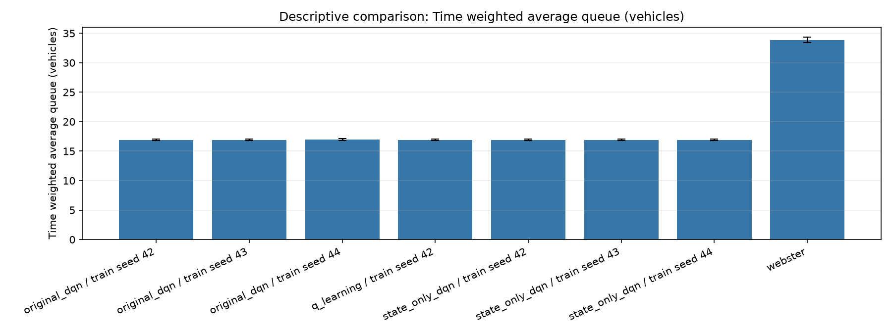
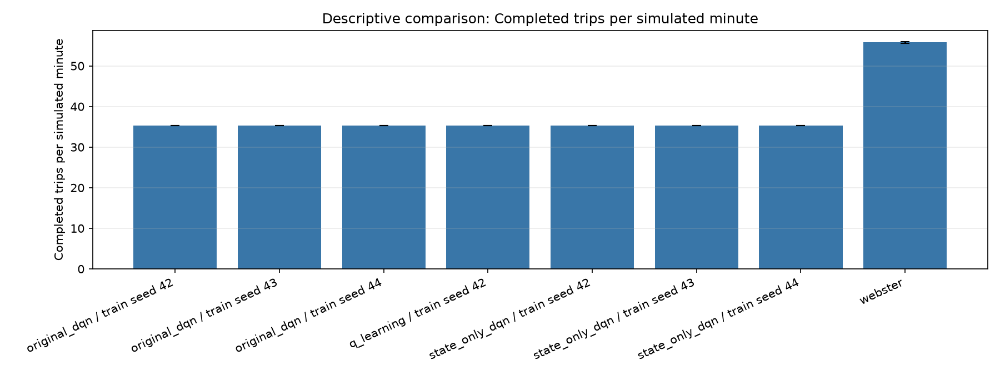
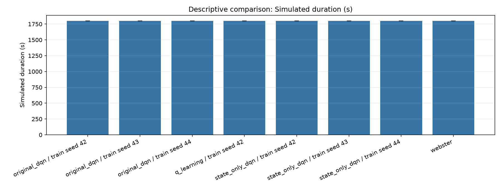

# Four-controller SUMO comparison

Status: **candidate_comparison**

Descriptive summaries only; this report makes no superiority claim.

Waiting time includes completed trips only. Queue is the time-weighted sum of inbound halting vehicles. Throughput counts completed trips per simulated minute. Webster reward is reference only.

| Controller | Training seed | n | Avg queue (mean ± SD) | Completed-trip stopped wait (s, mean ± SD) | Throughput/min (mean ± SD) |
|---|---:|---:|---:|---:|---:|
| original_dqn | 42 | 30 | 16.904 ± 0.126 | 29490.233 ± 214.284 | 35.328 ± 0.026 |
| original_dqn | 43 | 30 | 16.904 ± 0.126 | 29490.233 ± 214.284 | 35.328 ± 0.026 |
| original_dqn | 44 | 30 | 16.950 ± 0.151 | 29568.567 ± 278.610 | 35.291 ± 0.023 |
| q_learning | 42 | 30 | 16.904 ± 0.126 | 29490.233 ± 214.284 | 35.328 ± 0.026 |
| state_only_dqn | 42 | 30 | 16.900 ± 0.127 | 29485.767 ± 217.821 | 35.329 ± 0.026 |
| state_only_dqn | 43 | 30 | 16.900 ± 0.127 | 29485.767 ± 217.821 | 35.329 ± 0.026 |
| state_only_dqn | 44 | 30 | 16.911 ± 0.135 | 29497.667 ± 237.642 | 35.322 ± 0.032 |
| webster | n/a | 30 | 33.885 ± 0.473 | 59117.633 ± 869.891 | 55.792 ± 0.180 |

## Generated plots

- 
- 
- 
- 

## Fairness and interpretation

Every row uses the same route file, horizon, decision interval, and evaluation seed schedule. Inserted counts are checked per paired seed and mismatch is flagged. Waiting time is limited to completed trips by the adapter; unfinished-vehicle waiting is unavailable. Learned controllers retain different state representations as documented in comparison_config.json.
